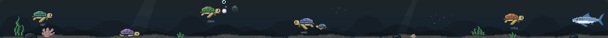
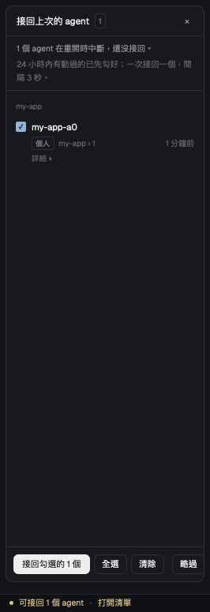

# herdr-mods

Two mods for the [Herdr](https://herdr.dev) desktop app (built and tested on Herdr 0.1.16 on macOS).

| Mod | What it does |
|---|---|
| [**aquarium**](aquarium/) | A pixel-art strip under your terminals. Every agent is a sea turtle: it swims while working, floats up when done, sleeps on the sand when idle, and a shark drifts over when it is blocked and waiting for you. You can feed the turtles; fish and a distant shark pass by now and then. |
| [**agent-restore**](agent-restore/) | Brings Claude Code agents back after a reboot. It keeps a snapshot of every agent (launch flags, config dir, session id), and after a reboot lists the ones that were cut off in the right-hand panel. One click resumes them in their original panes with their original flags and account. |

   
  

## Install

Each folder follows the herdr.dev gallery layout: `mods/<name>/`, a `RECIPE.md` (a brief an agent can rebuild it from) and a `preview.png`.

- **Ask your Herdr agent:** "Add the mod at https://github.com/ianlkl11234s/herdr-mods/tree/main/aquarium" (or `agent-restore`). Herdr's `AGENTS.md` tells it how.
- **By hand:** copy `<folder>/mods/<name>/` into `~/.config/herdr-app/mods/`, then add the block(s) shown in that mod's `README.md` to your layout and run `herdr-app check ~/.config/herdr-app/mods/<name>`.

Read each mod's README first. **agent-restore runs `hc` and shell commands, reads Claude Code's session files and transcripts, and types `claude --resume …` into your terminals**; its README says exactly what and why.

UI text is English by default; set the block prop `"lang": "zh-TW"` for Traditional Chinese.

**Status:** agent-restore has been tested by killing one terminal's shell (how herdr-core sees a lost program), not yet through a real reboot, and its English UI has only been checked in code, not on screen. See its README for what is and isn't tested. Bug reports welcome.

## License

MIT. See [LICENSE](LICENSE).

---

### 繁體中文

兩個給 Herdr 桌面版的 mod：

- **aquarium（水族館）**：終端機下方的像素海底。每個 agent 是一隻海龜，工作時會游，完成時浮上來，閒置時睡在沙上，等你處理時有鯊魚靠近。可以餵食，偶爾有魚群和遠方的鯊魚經過。
- **agent-restore（重開機接回）**：記錄每個 Claude Code agent 的啟動參數、設定資料夾和 session 編號。重開機後在右邊面板列出被中斷的 agent，一鍵在原本的 pane 用原本的參數和帳號接回。

在 block 的 props 加 `"lang": "zh-TW"` 就會顯示繁體中文。安裝方式和注意事項見各 mod 的 README。
