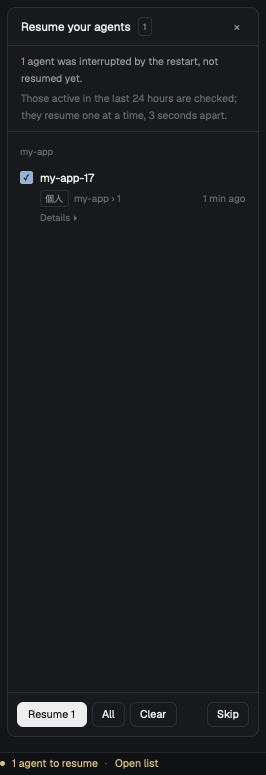

# agent-restore

After a reboot, Herdr's kept terminals come back as fresh shells, and the Claude Code agents that ran
in them are gone. With this mod, a thin amber line appears under the work area: "2 agents to resume ·
Open list". The side panel opens on a list of the interrupted agents, grouped by space. Each row has
a checkbox, the agent's title, its account, `space › tab` and how long ago it was active. Press
"Resume 2 checked" and the mod types `claude … --resume <id>` back into each agent's own terminal,
one at a time. When nothing waits, the line and the list take no room.

## What you see

**The notice bar** (`restore-bar`).
- **Size and place:** a block in the `work` column, between `work-body` and `status`. It is 0 px while nothing can be resumed, and 26 px when something can.
- **Look:** `chrome` background with a 1 px `border` line on top, 14 px horizontal padding, 8 px gaps, 11.8 px text, left-aligned.
- **Contents, left to right:**
  1. a 6 px round dot in `ansi3`;
  2. `N agents to resume` in `ansi3` (`1 agent to resume` for one);
  3. a `dim` `·`;
  4. `Open list` in `ansi3`, `foreground` on hover.
- The whole bar has a pointer cursor.

**The list** (`restore`).
- **Place:** the third child of the side panel stack `panel-body`, after `files` and `changes`, in the `panel` column (368 px in Herdr's `main.json`, 280 px at least).
- **Frame:** fills the column, 10 px radius, `background` fill, 1 px `border`, 13 px text.

Top to bottom:

1. **Header**, 42 px, 14 px side padding, `border` line below:
   - `Resume your agents`, semibold;
   - a count badge: 10 px, 1 px `border`, `muted`;
   - a spacer;
   - a `×` in `muted` that gets a `hover` background.
2. **Summary**, 8 px vertical padding, `border` line below, 11.5 px `muted`:
   - `N agents were interrupted by the restart, not resumed yet.`, or `No agents to resume.`;
   - when there are rows, a `dim` line: `Those active in the last 24 hours are checked; they resume one at a time, 3 seconds apart.`;
   - after a resume, `✓ Resumed N`.
3. **Rows**, scrolling with a vertical scrollbar, 6 px padding.
   - **Group header:** 10.5 px, semibold, `dim`. It is the group's name from `space-groups.json`, else the space's name.
   - **Row:** 8 px by 7 px padding, 7 px radius, `hover` background under the pointer.
     - **Checkbox:** 14 px, radius 3. Checked: filled `accent` with a 10 px `✓` in `accent_foreground`. Unchecked: `background` with an `input` border.
     - **Title:** 12.5 px, semibold, `foreground`. It turns `muted` when the tab is gone or the row is queued. A tag follows it: `queued`, `resuming`, or `not resumed`. The tag is 10.5 px, in `ansi3` when it failed and `muted` otherwise.
     - **Meta line**, 11 px `dim`:
       - an account badge: 10 px, `muted`, 1 px `border`, radius 4, 5 px padding;
       - `space › tab`, cut short with an ellipsis;
       - `just now` / `12 min ago` / `3 h ago` / `2 d ago`.
     - **Notes**, 11 px `ansi3`, one line each:
       - `Was working before the restart: ask it where it got to.`
       - `Was waiting for your answer: it will stop at the same question.`
       - `Its tab was closed: copy the command and paste it yourself.`
       - `Not resumed: <why>. Try again, or copy the command and paste it yourself.`
     - **`Details ▸`** (`Less ▾` when open): 10.5 px `dim`, `foreground` on hover.
     - **Details box**, opened by that link: 8 px padding, radius 6, `surface` fill, 1 px `border`. It holds three parts, each with a 10.5 px `dim` label:
       1. `You said last`, with 11.5 px `muted` text, or `(nothing read)`;
       2. `Agent replied last`, the same;
       3. `Resume command`, with a small `Copy` chip (`Copied` for 1.5 s) and the command in the terminal font (`settings().font_family`, else JetBrains Mono) at 10.5 px.
4. **Footer**, 10 px padding, 6 px gaps, `border` line above. Buttons are 28 px tall, radius 7, 12 px text.
   - **Primary button:** `Resume N` (English; zh-TW `接回勾選的 N 個`), or `Resuming…` while busy. 12 px side padding, `solid` fill with `solid_foreground` text; `raised` with `dim` text when disabled.
   - **Outlined buttons:** `All`, `Clear`, a spacer, then `Skip`. Keep the English labels this short: at 266 px the longer `Resume N checked` / `Select all` pushed `Skip` out of the panel. 10 px side padding, 1 px `border`, `foreground` text (`dim` when disabled), `hover` background.

With `lang: "zh-TW"`, every string is the Traditional Chinese one from `strings.js`.

## How it behaves

**Recording.**
- The bar copy records a round every 30 seconds, and at once whenever any agent's status changes. Its render compares `agents()` `address:status` pairs.
- A round covers every local, live terminal that `hc ls` reports as `claude-code`, or that the snapshot already knows.
- It records a terminal only when the terminal's foreground is `claude`, it has `keep: true` and the `herdr.space` and `herdr.tab` labels, and it was not started with `-p/--print` or `--no-session-persistence`.
- It finds the session in `~/.claude*/sessions/<claude pid>.json`.
- It reads the transcript's tail only when the status or title changed, plus up to 3 more rounds while your last message or the agent's last reply is still missing.

**Agent statuses.** The mod does not draw agent status; Herdr's own list does. It keeps the last `status.state` it saw:

| Status before the restart | On the row |
|---|---|
| `working` | the note "Was working…" |
| `blocked` | the note "Was waiting for your answer…" |
| `done`, `idle` | no note |

**Judging** an entry whose terminal no longer runs `claude`:

| The terminal | Verdict |
|---|---|
| New root pid, or a snapshot older than `kern.boottime` | Resumable |
| Same root pid | The person ended it: `exitAt` is set, and the entry is deleted on a round at least 25 seconds later; it is never listed |
| No foreground | In between: no verdict |
| Gone, and the entry was running | Deleted: the tab was closed |
| Gone, and the entry was already resumable or older than this boot | Kept, marked gone |
| A resumable session runs in some terminal again | Deleted |

**Clicks.**
- **Bar:** opens the list: `layout.select {stack: "panel-body", child: "restore"}`, then `layout.show {id: "panel"}`.
- **Checkbox:** toggles the row.
- **`Details ▸`:** toggles the details box.
- **`Copy`:** puts the command on the clipboard with `pbcopy`.
- **`×`:** `layout.hide {id: "panel"}`.
- **`All`:** checks every row that is not queued or resuming.
- **`Clear`:** unchecks every row.
- **`Skip`:** sends `agent-restore.skip:<addresses>`. The bar deletes those entries, unless one is queued.
- **`Resume N`:** sends `agent-restore.resume:<addresses>` for the checked rows whose tab still exists.

**Checked at first.** A row is checked the first time the list sees it, if it was active in the last 24 hours and its tab still exists.

**Opening by itself.** The first time in an app run that something can be resumed, the bar opens the list once. A `globalThis` flag remembers that it did.

**Resuming.** The bar keeps a queue and resumes one entry at a time, 3 seconds apart. For each entry:
1. It refuses if the same session is in flight, or if a sessions file with that id belongs to a live `claude` whose `ps lstart` equals the file's `procStart`.
2. `hc get` must show the root shell idle in the foreground.
3. `hc send <address> "cd '<cwd>' && [CLAUDE_CONFIG_DIR=<dir> ]<argv minus session flags and prompt> --resume <id>"`.
4. It polls `hc get` every 0.5 s for 10 s until `claude` is in the foreground.
   - Then it records the entry again at once as live, with the new root pid, so a later `/exit` is judged against the new shell.
   - Otherwise the row says `not resumed` and why.

The row's tag reads `queued`, `resuming` or `not resumed` meanwhile. When nothing is left, the bar resizes itself to 0 px.

## Built from

**Files.** One mod, `mods/agent-restore/`:

| File | Job |
|---|---|
| `main.js` | Picks a part by `props.role` and passes the props to its `init(cx, props)` |
| `bar.js` | Recorder, judge, resume queue and the notice line |
| `panel.js` | The list |
| `core.js` | `hc` and file helpers, argv parsing, quoting, the snapshot |
| `strings.js` | The `en` and `zh-TW` string tables |
| `mod.json` | `{"place": "none", "title": "Agent restore"}`: Herdr never docks a copy by itself |

**Layout.** Two blocks in the person's layout: `restore-bar` and `restore`.

| Block | Props |
|---|---|
| `restore-bar` (`{"px": 0}`) | `{"role": "bar", "lang": "en", "accountLabels": {...}}` |
| `restore` | `{"role": "panel", "lang": "en"}` |

Neither block uses another mod. They rely on the `panel` column and the `panel-body` stack of Herdr's `main.json`.

**Herdr functions.** `hc`, `exec`, `home`, `appHome`, `readTextFile`, `fs/promises` (`readdir`, `exists`, `mkdir`, `writeFile`), `theme`, `agents`, `spaces`, `settings`, `run`, `shared`/`setShared` (key `agent-restore`: `{n, rev, progress}`), `nextCommand`, `checking`, `props`.

**Commands it runs.** `layout.resize {id: "restore-bar", px}`, `layout.select`, `layout.show`, `layout.hide`.

**Its own commands.** `agent-restore.open`, `.status`, `.refresh`, `.resume:<a,b>`, `.skip:<a,b>`.

**Programs.**
- `hc ls --json`, `hc get --json <t>`, `hc send <t> <text>`;
- `sysctl -n kern.boottime`;
- `env LC_ALL=C TZ=UTC ps -o lstart=,comm= -p <pid>`;
- `sh -c` with `wc -c`, `tail -c`, a `for` loop over `projects/*/<id>.jsonl`, and `umask`, `chmod`, `cp`, `mv` to write the snapshot;
- `pbcopy`.

**Data.**
- **Snapshot:** `<appHome>/data/agent-restore/snapshot.json`, keyed by terminal address. It is written through a temp file and `mv`, keeps the last version as `snapshot.prev.json`, and is `0600` in a `0700` folder.
- **Transcript path:** `<config>/projects/<cwd with every non-alphanumeric character turned into "-">/<sessionId>.jsonl`. When that file is missing, the mod looks for `<sessionId>.jsonl` in any `projects/*/` folder.
- **What it keeps from the transcript:**
  - your last message: plain text, a `<hc from=…>` message unwrapped, or a slash command with its arguments;
  - the agent's last text reply;
  - both cut to 400 characters.

No art.

## Watch out

- **Fixed layout ids.** The code names `panel` (the column it shows and hides), `panel-body` (the stack it selects in), `restore` (its list block) and `restore-bar` (the block it resizes). Other ids break the open, close and resize calls silently.
- **Telling a lost agent from one the person ended.** Compare the terminal's root `pid` from `hc get` with the one recorded while `claude` ran.
  - **New pid:** herdr-core replaced the lost program with a new shell. The address and `created_ms` stay the same.
  - **Same pid, and the snapshot is from this boot:** the person ended it.
  - **Don't use** `reason`, `signal` or the `restarted` event. After recovery, `hc get` shows `reason: null` again, and a mod that was not running at the time never sees the events.
  - **Wait out a grace period** (25 s, judged on a later round) before forgetting an ended agent.
  - **Never decide while `foreground` is null.** That is the gap between the loss and the new shell.
- **`hc send` can tag what it delivers.** `hc --skill` documents messages arriving as `<hc from="t7 …">…</hc>`.
  - A transcript can hold that tagged form, so the reader unwraps it before quoting your last message.
  - In the test, `hc send` run as `env -u HC_TERMINAL_ID hc send …` from an agent's terminal delivered `echo`, the request and `/exit` exactly as typed.
  - The bar's own sends arrive as written: the resume command ran in the shell.
  - Not tested: what a tagged `/exit` or a tagged command line does when it reaches a shell. When testing by hand from inside a herdr-core terminal, unset `HC_TERMINAL_ID` as above.
- **The tabs mod's panel memory.** Herdr's shipped tabs mod remembers, per space, which panel page is open, and only knows `files` and `changes`. Switching spaces can hide the list. The bar stays and reopens it. Don't patch the tabs mod for this.
- **Props reach the parts through `init`.** Module code is shared by every copy of a mod. Keep `lang` and `accountLabels` on the instance, never in module scope. The account label is computed by the bar and stored in the snapshot; the panel only shows `e.account`.
- **zsh and `=`.** zsh expands a bare word that starts with `=` (`=ls` → `/bin/ls`). The quote function may leave a word bare only if it is all of `A-Za-z0-9_@%+=:,./-` and does not start with `=`. Anything else goes in single quotes, with `'` written as `'\''`. The `cd` folder is always quoted.
- **Stale session files.** Stale `sessions/<pid>.json` files survive a power cut. A session counts as running elsewhere only if that pid is still `claude` and its `ps lstart` (UTC, `LC_ALL=C`) equals the file's `procStart`.
- **`~/.claude` gets no `CLAUDE_CONFIG_DIR`.** It is Claude Code's default, and setting it makes Claude Code look for another login. Other `~/.claude-*` folders do get it.
- **`herdr-app check` writes files.** It writes `gpui-kit.d.ts` and `jsconfig.json` into the mod folder. Leave them out of the shared folder.
- **Limits:**
  - macOS only: `kern.boottime`, `pbcopy`, `ps lstart`;
  - local terminals only;
  - a closed tab is not reopened (copy the command instead);
  - transcripts are read up to 512 KB from the end.
- **Built and tested on** Herdr 0.1.16, herdr-core (`hc`) 0.1.21 and Claude Code 2.1. It has been tested with a SIGKILL of one terminal's shell, not yet through a real reboot.

## Done when

1. `herdr-app check mods/agent-restore` passes, and there is no `layout.error`.
2. **Recording:** with `claude` running in a kept terminal, `data/agent-restore/snapshot.json` has an entry for that address with `state: "live"` within 30 s. The file is `-rw-------` and its folder `drwx------`.
3. **A lost agent:** `kill -9` that terminal's root `pid` (from `hc get`). After `herdr-app do agent-restore.refresh`, the entry is `resumable`, the bar is 26 px, and the bar reads `1 agent to resume · Open list`.
4. **The list:** `herdr-app do agent-restore.open` shows the side panel with the row checked, under the space's name.
5. **Resuming:** `herdr-app do agent-restore.resume:<address>`. Within 10 s, `hc get` shows `claude` in the foreground with the original flags and `--resume <the same id>`. The new `sessions/<pid>.json` has the same `sessionId`. The bar goes back to 0 px.
6. **An agent the person ended:** `/exit` in it. The entry gets `exitAt`, is gone after a round 25 s later, and never appears in the list.
7. **Language:** with `lang: "zh-TW"` the same steps show `可接回 1 個 agent · 打開清單`. Without `lang`, the English strings show.
