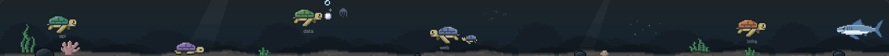

# Aquarium

A dark, quiet strip of sea along the bottom of the work area. Every agent is a pixel-art sea turtle with its space's color on
its shell, and its sub-agents are little turtles swimming behind it. Working turtles swim, idle ones sleep on the sand, finished
ones float up to the surface with a pearl, and when an agent is waiting for you a blue-grey shark swims in and stops closer the
longer it waits. Clicking a turtle or a shark jumps to its agent; clicking empty water drops fish food. Now and then a school of
small fish or a far-off shark silhouette passes through.



## What you see

**The strip.** A block 128 px tall in the work column, under the terminals and above the status bar, as wide as the column.
Inside it, 8 px of padding left, right and below (none on top), the tank: a 1 px border in the theme's `border` color, radius
10, everything clipped to it. The tank's own height is the block less 10 (118 px at 128). Sizes from `on_size_change` are window
pixels; divided by `settings().zoom` they are the units everything below is drawn in.

**Water.** Five flat bands, each drawn from its top (a fraction of the tank height) to the floor, so a lower one covers the one
above: 0 `#1c2329`, 0.18 `#1a242b`, 0.38 `#18242d`, 0.58 `#16232e`, 0.78 `#14212d`. Fixed colors for a dark theme, not theme
colors. Depths, with `TH` = 34: `sandTop` = height − 22, `surface` = 16, `swimTop` = 22, `swimBottom` = max(swimTop + 4, sandTop
− TH − 16), `rest` = sandTop − TH + 4.

**Backdrop**, back to front, all full-color SVGs at whole pixels. An item's left is round(fx × (tank width − its width)); its top
is a px value from the top, a fraction of `sandTop` (water), or `sandTop − its height + sink` (sand).

1. `rocks-far` (480×68), a dark rock-ridge silhouette tiled along the tank, its bottom 4 px into the sand.
2. Light beams from the top: `beam-wide` (96×128) at fx 0.21, `beam-narrow` (76×128) at 0.67; pale blue at 2–5% opacity.
3. A distant school `fish-school-2` (48×18) at fx 0.56, top 0.20 × sandTop.
4. `jellyfish` (14×18) at fx 0.385, 0.16; `plankton` (60×28) at 0.735, 0.40; both faint and see-through.
5. Back seaweed that sways ±1.5 px (periods 5.2 s and 6.7 s): `seaweed-1` (28×56) at fx 0.022 sinking 5, `seaweed-2` (38×30) at
   0.715 sinking 4.
6. `sand` (480×28), tiled along the bottom.
7. Front decor on the sand: `stone-1` (36×18) .04/9, `coral-1` (34×26) .07/5, `seaweed-3` (22×14) .295/5, `stone-3` (12×8) .47/9,
   `stone-2` (22×12) .655/8, `coral-3` (16×10) .682/6, `seaweed-3` .85/5, `stone-2` .95/9 (fx/sink).

Tiles start at −6 px and step by their width less 12, so neighbours overlap by 12 px.

**Actors**, drawn over the backdrop in this order: rising bubbles, the passing school, waiting sharks, little turtles, idle
turtles, the other turtles, then food. The far-off shark is drawn first of all, right after the water, behind the rocks.

- Turtle 56×34 px, little turtle 30×20, waiting shark 88×40: pixel art at 2 px a cell, one file per shell color and direction
  (`turtle-ansi6-r.svg`), turtles also in a sleeping version with closed eyes (`-sleep`). Shell colors `ansi6`, `ansi3`, `ansi4`,
  `ansi5`, `ansi2` and grey `plain`, each mixed 42% towards brown `#6f5c40`; olive skin, cream belly. The shark is light
  blue-grey with a white belly, round eye and no teeth.
- A finished turtle carries, from its top-left when it faces right (mirrored when it faces left): a pearl 12×12 at (58, 8), a
  6 px bubble at (66, −1) and a 10 px bubble at (58, −12), the bubbles drifting 3 px up and down (3.8 s, 4.6 s).
- Under each turtle, the space name: 9 px, centered, up to 72 px wider than the turtle and cut with an ellipsis, `#74818c` while
  its top is above `sandTop`, `#a9a69d` on the sand.
- Bubbles 6 or 10 px at 0.8 opacity; food flakes 8×6, warm tan; school fish 12×8 in grey-blue or dark silver; the far-off shark
  44×20 (the waiting shark's outline at 1 px a cell), one flat `#3f566b` at 0.42 opacity.

Nothing is red and nothing flashes or pulses.

## How it behaves

Every move is a start, a target and a duration, played by the app's own `.transition("left"/"top")` (linear); gentle bobbing is
a `.loop("top")`. Swim durations are rounded to whole 2 s ticks so the next decision comes as a swim ends. Speeds in px/s: swim
15, sink and rise 12, shuffle 5, shark 20, shark leaving 36, swimming to food 27, little ones 24.

**Agents.** One turtle per top-level agent from `agents()`. A new one appears at the farthest of 8 random spots from the others.

- `working`: swims 40–180 px left or right to a new depth inside the swim band, glides 6–18 s, swims again. Bobs 0→3 px (2.6–3.4
  s, by agent).
- `idle`: sinks to the nearest spot on the sand at least 62 px from other resting turtles, sleeps (closed eyes, no bob) 1–3 min,
  then half the time shuffles 10–34 px.
- `done`: rises straight up to `surface` and stays, with the pearl and bubbles. Bobs 0→2 px (4.4 s).
- `blocked`: stops where it is and faces the shark. Bobs 0→1.5 px (3.8 s). A shark is drawn 12 px past the nearer edge, or the
  other edge when the nearer side has less than 306 px of room, then swims in level with the turtle and waits nose-to-turtle at
  210 px; 165 after 1 min, 125 after 3, 92 after 6, 64 after 10 (clamped inside the tank). It bobs 0→2.5 px (4.2 s). When the
  status changes or the agent goes, it turns and swims off the side it came from.
- Sub-agents: live terminals in `terminals()` whose `parent` chain leads to an agent are its little ones, up to 3, each behind
  the parent (one little-turtle width plus 2 px, the next 24 px further), alternately level with its feet and 10 px higher,
  starting 500 ms after the parent moves. A sub-agent reporting `error` counts as blocked; any blocked little one makes the
  whole family blocked. Little ones bob 0→2 px (2.3 s) unless idle, and have no sleeping picture.
- When each agent's status changed is kept in `localStorage` (`since`), so a shark keeps its distance across reloads; a turtle
  seen for the first time takes its tab's `changed_at`. Entries of agents gone for 24 h are dropped.

**Pointer.** Hovering a turtle or a waiting shark shows a tooltip and gives that turtle its label even in a crowded tank
(crowded: under 120 px of width per turtle, where labels show only on hover; otherwise a label is skipped when it would
overlap a more urgent one). Clicking a turtle, a little one or a waiting shark runs `agent.focus` on it. A press on anything else
in the tank drops food there.

**Tooltips**, by the block's `props.lang` (`"en"` default, `"zh-TW"`):
`api › fix login · working 12 min`, `… · needs you, waiting 3 min`, `… · done, not seen yet`, `… · idle`, `api › tab 2 · …` for
an unnamed tab, `web › sub-agent <name> · …`, shark: `infra › deploy needs you, waiting 3 min`; times `under 1 min`, `12 min`,
`1 h 5 min`. In Chinese: `工作中 12 分鐘`, `等你處理，已等 3 分鐘`, `完成了，還沒看`, `閒置`, `分頁 2`, `子 agent`, `在等你，已等`,
`不到 1 分鐘`, `1 小時 5 分`.

**Feeding.** 3–5 flakes are drawn at the surface (4–12 px down) spread ±28 px around the press, and 150 ms later sink to the sand
in 6–8 s, swaying ±1.5 px. At most 10 in the tank. The one or two nearest `working`/`done` turtles swim to stand on either side
of the patch, nose over it, on the sand (a second one from the same side stands 28 px back and 9 px higher). Each flake fades in
0.5 s as it lands, 0.7 s apart; then the turtle lets go a 6 px bubble and after 3 s returns to its status. A turtle whose status
stops being awake on the way gives up; its flakes stay on the sand and fade after 30 s.

**Passers-by.** At most one group at a time; not clickable, no tooltip. A school: 5–9 fish of one kind, strung out up to 110 px,
crossing at ~30 px/s at slightly different speeds and depths, each bobbing ±1.5 px. On average every 4 min. A far-off shark:
at a random height in the upper half, crossing at 16 px/s with a slow 2 px bob, on average every 12.5 min; never while a
waiting shark or a blocked agent is in the tank (retried after 1 min), and a scheduled one already crossing fades out in 2 s.
Every wait is random between half and 1.5× the average, and the next group waits 30 s after one leaves.

**Demo** (`aquarium.demo`): a still cast laid out from the tank width, in its own tank state: `api` working near the top, `docs`
asleep on the sand, `data` done at the surface, `web` working low with a little one, `infra` blocked with its shark at the
3-minute distance on the right. Clicks do nothing, nobody moves except to feed and swim back, no passers-by come by themselves.

**Timer.** A tick every 2 s while anything is about to change (a working or blocked agent, a shark, food, a swim), else every
10 s; it redraws only when something changed. When the app re-renders because agents changed, the view compares a signature and
schedules a tick 1 ms later instead of waiting.

## Built from

One mod, `mods/aquarium`, `mod.json` `{ "place": "none", "title": "Aquarium" }`, placed by the layout:

```json
{ "id": "aquarium", "type": "block", "size": { "px": 128 }, "content": { "mod": "aquarium", "props": { "lang": "en" } } }
```

in the `work` column between `work-body` and `status` (in a cloned layout: shipped layouts take no new structure).

- `main.js`: the View. Reads `agents()` (address, status, space, `tab_name`), `terminals()` (`parent`, `state`), `spaces()`
  (each tab's `working_since`, `status`, `changed_at`), `settings().zoom`,
  `theme().border`, `props().lang`, shared `space.colors` (kept by the shipped `spaces` sidebar; read only). Writes shared
  `aquarium.demo` and `localStorage` `since`. Runs `agent.focus {terminal}`. Uses `nextCommand()` for `demo`, `demo-on`,
  `demo-off`, `feed`, `feed:<x>`, `visit-fish`, `visit-shark`; `cx.timer.every` / `after`, `on_size_change`, `on_mouse_down`,
  `on_click`, `on_hover`, `tooltip`, `.transition`, `.loop`, `image()`.
- `sea.js`: positions and moves, feeding included; no drawing. `visit.js`: the passers-by's schedule and paths. `demo.js`: the
  demo cast.
- Art: 65 SVGs in `art/`, one `<rect>` per horizontal run of a color, `shape-rendering="crispEdges"`: 24 turtles (6 shells × left/right
  × awake/asleep), 12 little turtles, `shark-l/r`, `far-shark-l/r`, `pearl`, `bubble`, `bubble-small`, `food`, `fish-pass-1/2-l/r`,
  and the backdrop (`rocks-far`, `sand`, `beam-wide`, `beam-narrow`, `seaweed-1..3`, `coral-1..3`, `stone-1..3`,
  `fish-school-1/2`, `jellyfish`, `plankton`). All come from the grids in `source/make_art.py` (Python 3 + Pillow);
  `python3 source/make_art.py` rewrites `art/`, `--out DIR` also writes PNGs, `spec.json` and preview sheets elsewhere.
- No programs (`exec`, `hc`), no `fetch`, no files read or written by the mod itself, no `keys.json`.

## Watch out

- Where it goes: a block in the `work` column between `work-body` and `status`, 128 px tall. Shipped layouts take no new
  structure, so clone one first. The art is laid out for 128 px (tank = block − 10 = 118 px); the beams reach down far enough
  for a block of up to 160 px.
- `on_size_change` reports window pixels; divide by `settings().zoom` to get the units the mod draws in. A click's
  `local_position` is scaled by the tank's size over `e.bounds` (or divided by zoom when bounds are missing).
- Herdr 0.1.16. `image()` takes SVG and PNG, and honours `fill-opacity` (beams, jellyfish, plankton use it).
- There is no horizontal flip: every sprite that faces a way is drawn twice (`-l`, `-r`), 65 files in all. Kids have no sleeping
  version.
- Art paths are `mods/aquarium/art/...` in code: renaming the folder means changing `ART` in `main.js`.
- A `.transition` only runs from one drawn state to the next. Anything that should glide in (a new shark, food, a bubble, a
  passing group) is drawn at its start first and given its target in a later frame (a 150 ms timer, or the next tick); a new
  shark is drawn past the edge, a new bubble invisible on the sand.
- `.loop` only swings back and forth; one-way movement is a `.transition` started by a state change.
- At zoom 0.9 the 28 px tiles come out about a device pixel short on each side and leave a dark seam: tiles overlap by 12 px.
  2 px cells are not whole device pixels at 0.9, so edges are softer than at 1.0.
- `herdr-app do aquarium.feed:300` hands `feed:300` to `nextCommand()`; `--x 300` is dropped. Shared values can't be set from
  the CLI, so the demo is a command the mod turns into `setShared`. Commands reach only shown copies.
- Under `herdr-app check` (`checking()`) the mod starts no command loop and no ticks.
- Read the props through `props()` at render time; `lang` defaults to English when absent.
- Label widths are estimated (5.3 px per ASCII character, 9.5 px otherwise) to decide overlaps.
- The far-off shark must stay a small dark silhouette behind the rocks; a full-color one reads as an agent waiting.
- The colors suit dark themes only. The demo has no grey (`plain`) shell.
- On a narrow tank the waiting shark is clamped inside it and may sit closer than its step says.

## Done when

- `herdr-app check mods/aquarium` passes.
- `herdr-app do aquarium.demo-on` shows five turtles labelled `api`, `docs`, `data`, `web`, `infra`: `docs` asleep on the sand,
  `data` at the surface with a pearl, `web` with a little turtle, and a shark on the right facing `infra`. Hovering `api` shows
  `Demo · api › fix login · working 12 min`, or `示範 · api › fix login · 工作中 12 分鐘` with `"lang": "zh-TW"`.
- `herdr-app do aquarium.feed:300` drops flakes around x = 300; one or two awake turtles swim over and the flakes fade one by one.
- `aquarium.visit-fish` sends a school across in about a minute; `aquarium.visit-shark` a dark silhouette behind the rocks.
- An agent that turns blocked brings a shark in from an edge; answering it sends the shark away. Clicking a turtle focuses its
  agent.
- `python3 source/make_art.py --out DIR` writes 65 SVGs identical to `art/`.
